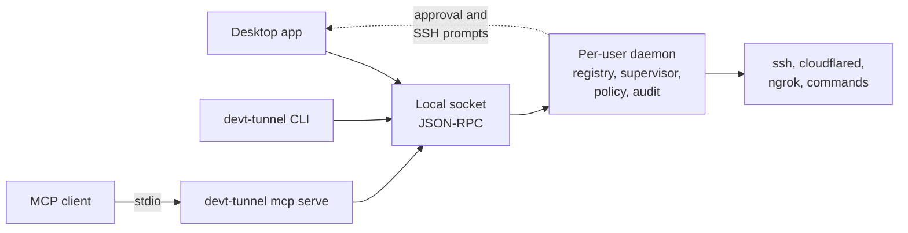

<div align="center">
  
  <h1>devt-tunnel</h1>
  <a href="docs/platform.md"></a>
  <a href="docs/platform.md"></a>
  <a href="docs/platform.md"></a>
  <div>
    <a href="LICENSE"></a>
    <a href="https://github.com/trieu04/devt-tunnel/actions/workflows/check.yml"></a>
  </div>
</div>

## Project Overview

> **Connect your tunnels in one click.**
>
> SSH, cloudflared, ngrok and custom commands, all in one place and without memorizing flags.

devt-tunnel is a desktop app to define, find and run tunnels. It drives the binaries already installed on the machine and reuses `~/.ssh/config`.

- The **desktop app** is the main product.
- The **`devt-tunnel` command line** complements it: people and agents use it to create managed tunnels in place of plain `ssh`, `ngrok` or `cloudflared` commands.
- **MCP** is a secondary channel for agents to create tunnels, with approval in the app according to policy.

> [!IMPORTANT]
> **Early code base, no public release yet.** Features are implemented and tested automatically, but only macOS has been checked by a person in the native app.
>
> | Area | State |
> | --- | --- |
> | Desktop app, daemon and tunnel engine | Native macOS acceptance passed |
> | `devt-tunnel` CLI, leases, policy and approvals | Implemented; native macOS approval passed |
> | MCP server | Implemented with automated checks; real-client check pending |
> | Windows and Linux | Compile in CI; not yet run on a real desktop |
> | Installers | Unsigned builds automated; signing needs owner infrastructure |
>
> Open work is in the [roadmap](docs/roadmap.md).

## Features

- **Four tunnel types**: SSH (`-L`, `-R`, `-D` forwards), Cloudflared (named or quick), ngrok, and any custom command.
- **Global quick launch**: A shortcut from anywhere (⌥Space on macOS, Ctrl+Alt+Space on Windows and Linux) to search by name, host or port and start or stop with Enter.
- **Create without memorizing flags**: Start from an `~/.ssh/config` host, a pasted `ssh`, `ngrok` or `cloudflared` command, or manual input.
- **What you see is what runs**: The editor shows the exact generated command and checks it before saving: resolved binary, host alias, port conflicts, unsafe flags and missing secrets.
- **Supervised processes**: Readiness detection, live logs, automatic reconnect with backoff, recovery after sleep and wake, and a stop that takes the whole process tree with it.
- **Profiles and groups**: Share an SSH config file across tunnels with a profile, and start or stop a whole stack with a group.
- **Vault**: API keys, tunnel tokens and passphrases stay in the OS keychain and are referenced by name. Revealing one requires OS authentication.
- **SSH prompts handled**: Passphrase, host-key and OTP prompts come to you through the app or the terminal.
- **Tray**: Running tunnels and favorites in the menu bar or notification area, where the desktop has one.
- **`devt-tunnel` CLI**: Shares one registry with the app through a per-user daemon, with `--json` output and stable exit codes for scripts.
- **Agent access under policy**: Leases, allow-lists, approvals and an audit trail for tunnels opened by agents.

## Installation

The app uses the binaries on your system and does not bundle `ssh`, `ngrok` or `cloudflared`.

### Packages

Release artifacts are created as a draft from `v*` tags. Until signed artifacts are published, [build from source](#build-from-source). Files named `-unsigned` are for testers only.

| Platform | Package | Notes |
| --- | --- | --- |
| macOS | `.dmg` | Once signed releases exist |
| Windows 10/11 | NSIS installer | Windows 10 may install the WebView2 runtime during setup |
| Ubuntu 24.04+, Debian 13+, Fedora | `.deb` or `.rpm` | GNOME may need a StatusNotifierItem extension for a tray icon |

The desktop packages also bundle `devt-tunnel`. On macOS, use **Install command-line tool** in Settings to put it on `PATH`.

### Build from Source

**CLI only** needs just Go 1.27.3 or newer, with no Node, GTK, WebView or display:

```bash
git clone https://github.com/trieu04/devt-tunnel.git
cd devt-tunnel
CGO_ENABLED=0 go build -o bin/devt-tunnel ./cmd/devt-tunnel
```

**Desktop app** also needs Node 22, pnpm, the Wails CLI and, on Linux, GTK and WebKitGTK. See [CONTRIBUTING.md](CONTRIBUTING.md#prerequisites).

```bash
wails3 task build
```

```bash
wails3 task package
```

## Usage

### First Tunnel in the App

1. Click **New tunnel** and choose **SSH**. The editor also accepts a pasted `ssh`, `ngrok` or `cloudflared` command (⌘⇧V).
2. Pick a host from your SSH config and add a local forward.
3. Review the generated command and checks, then click **Save & start**.

If a required secret is missing, the tunnel shows `Needs token`; add it in the Vault and the start retries.

### First Tunnel from a Terminal

```bash
devt-tunnel add ssh db --host server1 -L 5433:127.0.0.1:5432
devt-tunnel start db
devt-tunnel stop db
```

Tunnels created this way also appear in the app. See the [quick start](docs/cli/quickstart.md).

Screens and [shortcuts](docs/product.md#shortcuts) are described in the product guide. On Windows and Linux, ⌘ maps to Ctrl.

## How it Works



- **One daemon**: A per-user daemon starts on demand and owns the registry, supervisor and prompts. The app, `devt-tunnel` and MCP are clients of the same local API, so they always show the same state.
- **Process supervision**: Tunnels run as process groups (Job Objects on Windows), so a stop leaves nothing behind. Orphans are detected after a crash.
- **Ownership**: Saved tunnels are shareable definitions. Ephemeral tunnels from `devt-tunnel` or an agent are not written to `tunnels.toml`, are removed when they stop, and can be saved.
- **Leases**: A client's claim on a tunnel until a set time. A person's stop always wins.

Details are in [architecture.md](docs/architecture.md) and the [control plane design](docs/design/control-plane.md).

## Command-line Tool

Use `devt-tunnel` in place of the commands you already know:

```bash
devt-tunnel run -- ssh -N -L 5433:127.0.0.1:5432 server1   # Run a familiar command under supervision
devt-tunnel forward server1 5433:5432                      # Short form, stays in the background
devt-tunnel expose 3000 --via cloudflared --ttl 15m        # Expose a local service publicly
devt-tunnel ls                                             # All tunnels and their owners
```

`devt-tunnel docs` shows the guides offline. See [replacing traditional commands](docs/cli/replacing.md), [scripts](docs/cli/scripts.md), [troubleshooting](docs/cli/troubleshooting.md) and the [command reference](docs/cli/reference/devt-tunnel.md).

## Agents and MCP

Print the configuration for your MCP client and register it:

```bash
devt-tunnel mcp config
```

The agent asks for a tunnel and the daemon decides whether it is allowed, needs a person, or is denied. Public tunnels always need a person unless policy denies them outright. Remote SSH forwarding and destinations that are not allow-listed may also need approval. Policy is edited in **Settings → Agents**, where active leases can also be revoked.

See the [agent guide](docs/cli/agents.md).

## Privacy & Security

**What's stored on disk** — `tunnels.toml` contains definitions and secret names, not secret values, and can be shared after reviewing hostnames, paths and custom commands. Per-machine paths and shortcuts are in `settings.toml` beside it, and runtime metadata is in the OS state directory.

**Where secrets live** — In macOS Keychain, Windows Credential Manager or Linux Secret Service. There is no plaintext fallback. Values are accepted only from a hidden prompt or stdin, never from flags.

**What gets logged** — Tunnel output stays in memory. The rotating application log excludes secret values.

**What reaches the network** — The optional release update check is the app's only network request of its own. Tunnel processes make their normal connections.

**What agents cannot do** — Change policy, answer SSH prompts, approve their own requests, read or write secret values, or run arbitrary commands through MCP. Approval needs a person, in the app or in a terminal with the confirmation code. Requests and decisions are recorded in the audit log.

The API is local only: there is no network listener.

## FAQ

<details>
  <summary><strong>Why not just use <code>ssh -L</code> or <code>autossh</code>?</strong></summary>

For a single forward you use once, plain `ssh` is fine. devt-tunnel adds reconnects, status, logs, port-conflict checks and a clean stop, and puts every tunnel and its owner in one list.
</details>

<details>
  <summary><strong>Does it replace <code>ssh</code>, <code>scp</code> or <code>rsync</code>?</strong></summary>

No. It handles tunnels only. Keep using `ssh` directly for interactive sessions, `scp` and `rsync`.
</details>

<details>
  <summary><strong>Do I need to install ssh, ngrok or cloudflared separately?</strong></summary>

Yes, the ones you use. The app finds them on your system, and you can set a per-tool path in Settings.
</details>

<details>
  <summary><strong>Do tunnels keep running when I close the window?</strong></summary>

With a tray, closing the window only hides it and tunnels keep running. Without a tray host, closing the window quits the app. ⌘Q stops all tunnels and quits. If the app crashes, the daemon and tunnels keep running and a relaunch reconnects.
</details>

<details>
  <summary><strong>Can an agent open a public tunnel without me?</strong></summary>

No. A public tunnel waits for a person, or is refused if policy denies it. Agent access can be turned off completely in Settings.
</details>

<details>
  <summary><strong>How do I share tunnels with my team?</strong></summary>

Copy `tunnels.toml` after reviewing its hostnames, paths and custom commands. It holds secret names only, so each person adds their own values.
</details>

<details>
  <summary><strong>Can I manage tunnels on a headless server?</strong></summary>

Not yet. Running `devt-tunnel` on a server and managing it through its daemon socket, similar to `docker context`, is a [later stage](docs/roadmap.md#later-headless-servers).
</details>

## Documentation

| Document | Covers |
| --- | --- |
| [CLI guides](docs/cli/quickstart.md) and [command reference](docs/cli/reference/devt-tunnel.md) | Using `devt-tunnel` |
| [Agent guide](docs/cli/agents.md) | MCP tools, policy and approvals |
| [Product](docs/product.md) | Concepts, flows, screens, shortcuts |
| [Architecture](docs/architecture.md) | Process model, SSH, secrets, storage, decisions |
| [Platform](docs/platform.md) | Stack, per-OS differences, validation matrix |
| [Control plane](docs/design/control-plane.md), [CLI](docs/design/cli.md), [MCP](docs/design/mcp.md) | Daemon API, policy and interface contracts |
| [Roadmap](docs/roadmap.md), [release checklist](docs/release.md) | Open work and shipping |

## Contributing

Read [CONTRIBUTING.md](CONTRIBUTING.md) for the development setup, tests, generated files and project layout.

## License

Licensed under the [Apache License, Version 2.0](LICENSE). Bundled fonts keep their own licenses (SIL OFL) in `frontend/public`.

## Acknowledgments

- [Wails](https://wails.io) - Desktop application framework
- [React](https://react.dev) - User interface
- [Cobra](https://github.com/spf13/cobra) - Command-line framework
- [MCP Go SDK](https://github.com/modelcontextprotocol/go-sdk) - Model Context Protocol server
- [go-keyring](https://github.com/zalando/go-keyring) - OS keychain access
